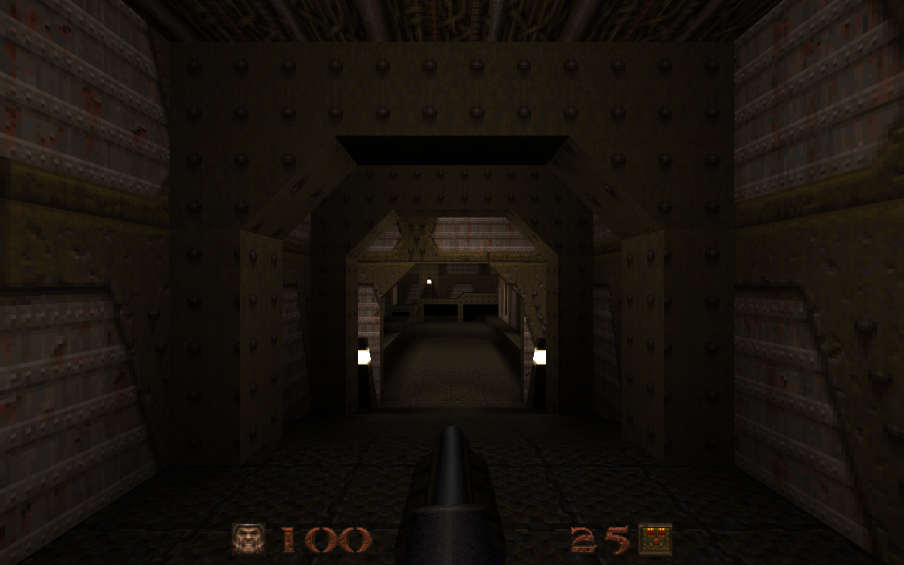
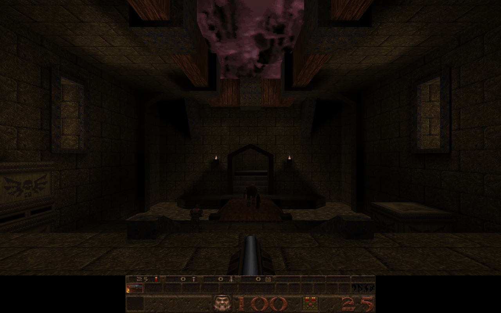

# Quake-style engine — React + TypeScript

A Quake engine written from scratch for the browser. Drop the **shareware `pak0.pak`** onto the page and it loads the main menu, the QuakeC game logic and the shareware levels (`start`, `e1m1`–`e1m8`).

No Quake engine, port or game engine is used. React is the app shell, and Three.js is used only as a general-purpose WebGL wrapper (textures, buffers, shaders). Everything else is in `src/engine/`: PAK/WAD/BSP/MDL parsing, collision, physics, the QuakeC VM and the game flow. The file formats were implemented from my own knowledge of them.

## Features
- Runs the original `progs.dat` QuakeC logic: monsters, doors, platforms, items, weapons, triggers, teleporters, skill hall and level changes.
- Smooth motion: entity positions and angles (doors, platforms, monsters, and the camera) are interpolated between the 72 Hz physics ticks.
- Animated models blend from the previous pose to the next over 0.1 s, so frame changes don't snap (the original engine does not do this).
- Two HUDs: a minimal Ironwail-style HUD (the default) and the classic status bar, selectable in Options.
- Drop the PAK onto the page, or click to choose it. The file is parsed in the browser and never uploaded.
- Console log in the browser's developer tools shows map loads, pickups, centre prints and messages (`[quake]` prefix).

## Screenshots

| Minimal HUD (E1M1) | Classic HUD (E1M2) |
|---|---|
|  |  |

## Run

```bash
npm install
npm run dev        # development server
npm run build      # production build -> dist/index.html (single file)
```

Open the page and drag `id1/pak0.pak` (the 18.7 MB shareware file) onto it, or click to choose it. The file is parsed locally and never uploaded. Without the PAK there is no content, because the engine has no placeholder assets.

### Controls
| Action | Keys |
|---|---|
| Move | WASD / ↑↓ (Shift toggles walk/run, "Always run" is on by default) |
| Look | Mouse (click to capture), ←/→ turn |
| Fire / Jump | Left mouse or Ctrl / Space or right mouse |
| Weapons | 1–8, mouse wheel |
| Pause / Menu | P / Esc |

The menus are the original ones: Single Player (New Game, Load, Save), Options, Help pages and Quit. Multiplayer is shown as unavailable. Options includes **HUD Style**: `minimal` (an Ironwail-style HUD, the default) or `classic` (the original status bar, with an opaque background). The choice is saved in the browser.

## Architecture (`src/engine`)
| File | Role |
|---|---|
| `pak.ts` | PAK directory and file extraction, WAD2 lumps, `qpic` decoding |
| `bsp.ts` | BSP v29 loader: planes, textures, faces, lightmaps, vis, nodes, clipnodes, models, entity lump. Builds the 3 collision hulls and provides point-in-leaf, PVS and light sampling. |
| `mdl.ts` | Alias model (`.mdl`) loader: skins, frames and frame groups, smooth normals |
| `progs.ts` | QuakeC bytecode VM for `progs.dat` v6: all 66 opcodes, call stack, local save/restore, string table, entity field memory |
| `builtins.ts` | QuakeC builtins, registered by name from the progs function table: traceline, aim, walkmove, movetogoal, droptofloor, checkbottom, find/findradius, sound, particle, the Write* message stream and others |
| `server.ts` | Entity system, hull tracing (`SV_Move`-style) against the world, brush models and boxes, entity linking and trigger touching, and the movetypes (walk, step, toss/bounce, fly, push with blocking, noclip). Includes player friction, acceleration and air acceleration, water movement, stair stepping, spawning from the entity lump, level changes, spawn parms and save/load. Runs at a fixed 72 Hz. |
| `renderer.ts` | Three.js renderer: world and brush entities per texture, packed lightmap atlas with animated light styles, animated textures, turbulent water, scrolling two-layer sky, fullbright pixels, alias models, view model, particles, beams, dynamic lights |
| `sound.ts` | WAV lumps (with loop cues) played through WebAudio with Quake-style distance attenuation, panning, entity channels and ambient loops |
| `assets.ts` | Palette, colormap, lump and WAD pictures, conchars font |
| `game.ts` | Input, view (bob, punch angles, damage kick, stair smoothing, colour shifts), HUD (minimal or classic status bar), intermission, finale, menus, client effects (temp entities, trails, explosions) |

QuakeC runs unmodified from the PAK's `progs.dat`. It drives monsters, doors, platforms, items, weapons, triggers, teleporters, skill hall and level changes. The server reads the player's `v_angle`, buttons and impulse each tick. Engine events from QuakeC (sounds, lightstyles, centerprint, intermission, temp entities) go to the client through a small event interface.

## Testing without a browser
```bash
npx tsx scripts/headless.ts /path/to/pak0.pak e1m1   # runs the server and QuakeC for about 3 s of game time (226 ticks)
npx tsx scripts/check.ts   /path/to/pak0.pak         # BSP/MDL sanity checks
```

## Known limitations
- No CD music, demos or sprites (the explosion is particles plus a dynamic light). Multiplayer is not implemented.
- Rotating brush entities collide as axis-aligned boxes.
- Lightmap brightness has a 1.5× gain applied to approximate the original look. Adjust it in `renderer.ts` (`WORLD_FS`).
- The sandbox where this was built had no GPU. Rendering was checked with software WebGL in headless Chromium, and a real-GPU test would still be useful.

## Disclaimer

This project is not affiliated with, endorsed by or sponsored by id Software or ZeniMax Media. Quake is a trademark of id Software. The engine is an independent implementation, and the game data (`pak0.pak`) must be supplied by you.

## License

The engine source in this repository is released under the [MIT License](LICENSE). The Quake game data (`pak0.pak`, including `progs.dat`, models, sounds and maps) is not included and is not covered by this license. It belongs to id Software and must be supplied by the user.
